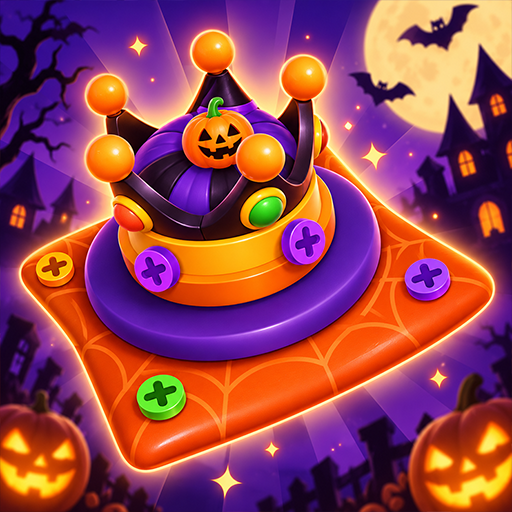
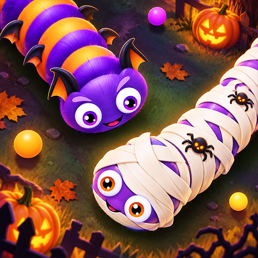

# Hi, I'm Sujith Aswin 👋

### Unity Developer · Software Engineer · Gameplay Systems

Building games with clean code, reusable systems, and smooth performance.

 
 

---

## 👨‍💻 About me

I'm a software engineer with **6+ years of experience** building games and applications with **Unity and C#**. My work spans mobile and WebGL games, multiplayer mechanics, live operations, and regulated casino gaming applications.

- 🎮 I build **gameplay mechanics, progression systems, and responsive UI**.
- 🧩 I design **modular, reusable systems** using object-oriented programming and design patterns.
- ⚡ I investigate production issues and optimize performance to keep games running smoothly.
- 🤝 I've led cross-functional teams of developers, designers, and testers through delivery and post-release support.
- 🌱 I'm expanding my knowledge of **modern .NET technologies**.

## 🛠️ Skills & toolkit

  

| Area | Skills |
| :--- | :--- |
| 🎮 Game development | Unity Engine, C#, gameplay systems, UI, progression systems, prototyping |
| 🏗️ Software design | Object-oriented programming, design patterns, data structures, modular architecture |
| 🔧 Plugins | Firebase, Admob, Ironsource |
| 🚀 Production & live operations | Performance optimization, debugging, ad integration, monetization, localization |
| 🤝 Development workflow | Git, AI-assisted development, team leadership, cross-functional collaboration |

**Platforms I've shipped for**

## 🎮 Projects beyond GitHub

A selection of published games I've contributed to, with links to their store or publisher pages.

### 🔩 Screw Genius 3D

A logic puzzle game where players strategically remove and sort screws to solve increasingly challenging puzzles.

**My contributions:** Gameplay mechanics, level design, and performance optimization.

`Puzzle gameplay` · `Level design` · `Optimization`

---

### 🐍 Slink IO 2

A snake battle game featuring competitive .io gameplay, multiple game modes, and customizable progression.

**My contributions:** Gameplay mechanics, reusable gameplay systems, and performance optimization.

`Competitive gameplay` · `Reusable systems` · `Optimization`

---

### 🎰 Hi-Score Series

**Out of the World & Alarm on the Farm**

A casino slot game series featuring dual themes and pachinko-style bonus mechanics.

**My contributions:** Localization, UI improvements, and bug fixes.

`Localization` · `UI improvements` · `Production support`

<!-- Add future projects here using the same structure: title, description,
     your specific contributions, and a store, playable demo, or video link. -->

---

### Let's build something worth playing.

Interested in my work or a collaboration? [Get in touch](mailto:sujithashwink@gmail.com).

